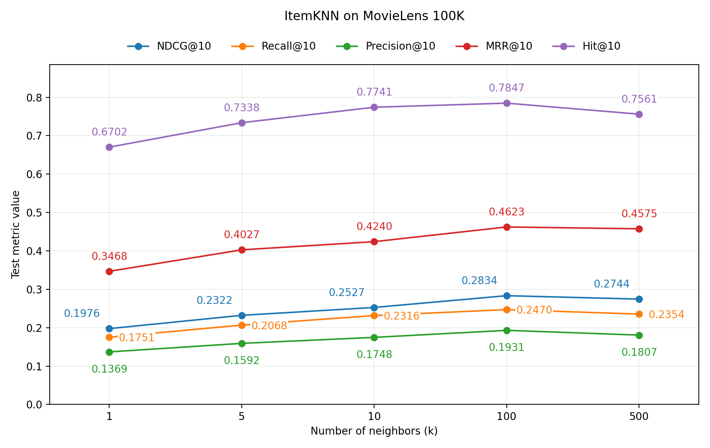
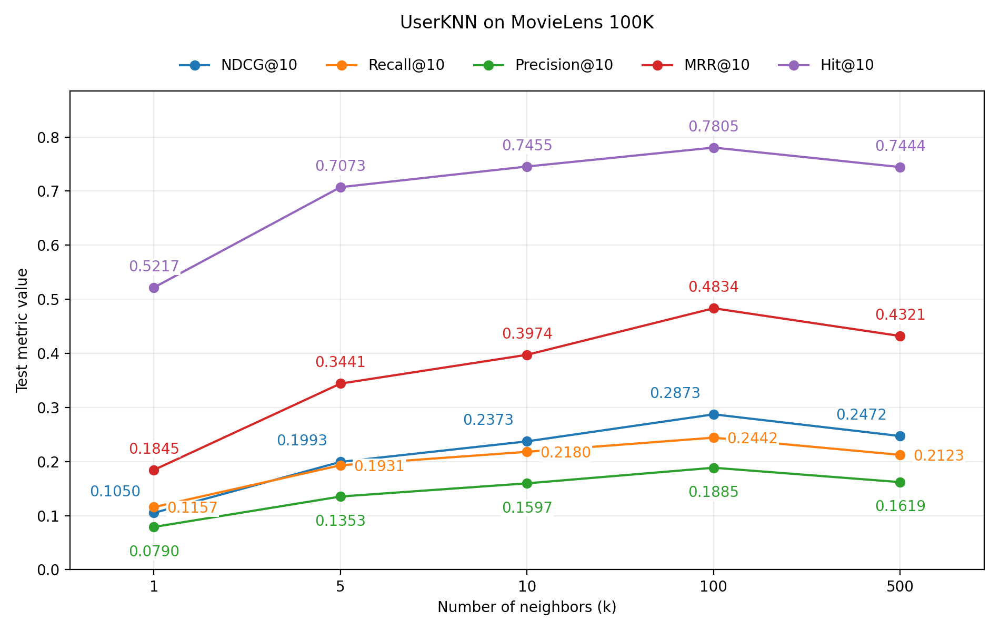
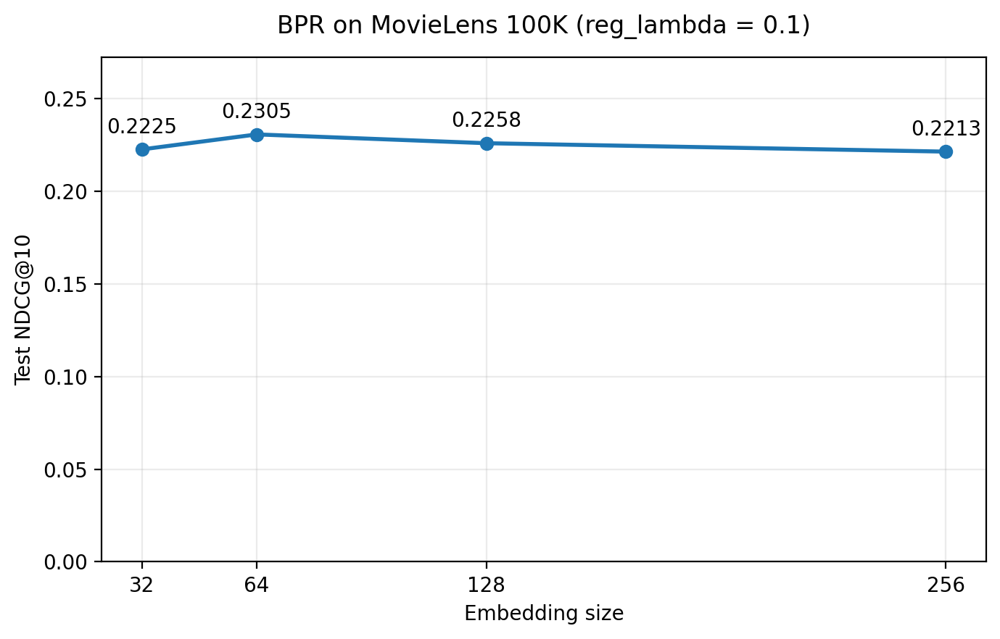
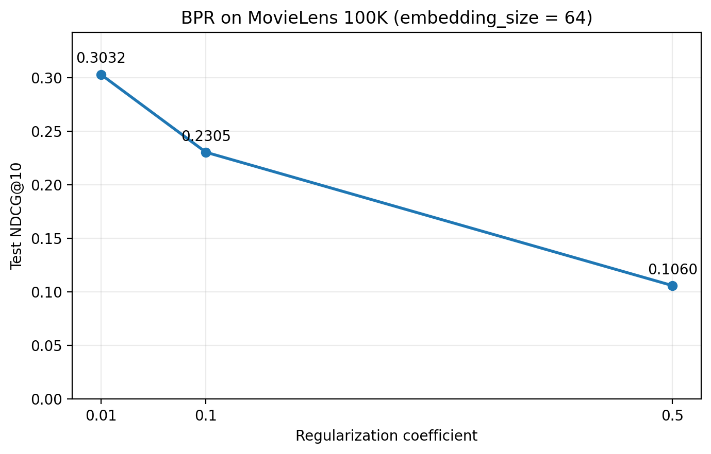
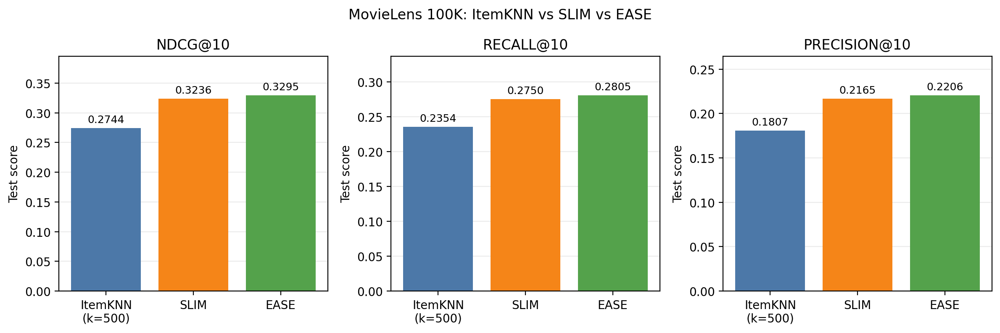

# 추천 시스템 HW1

MovieLens 100K(`ml-100k`)와 RecBole을 이용한 추천 모델 비교 실험이다.
ItemKNN·UserKNN의 이웃 수, BPR의 임베딩 크기와 정규화 계수를 비교하고,
SLIMElastic·EASE의 성능을 ItemKNN과 비교하였다.

## 실행 환경

실험은 macOS Apple Silicon의 CPU와 Conda 환경 `rs_hw1_py310`에서 수행하였다.

| 패키지 | 실험 버전 |
|---|---|
| Python | 3.10.22 |
| RecBole | 1.2.1 |
| PyTorch | 2.5.1 |
| NumPy | 1.26.4 |
| SciPy | 1.13.1 |
| pandas | 2.2.3 |

전체 패키지 목록은 [environment.yml](environment.yml)과
[logs/package_versions.txt](logs/package_versions.txt)에 기록하였다.
`environment.yml`은 위 macOS 환경에서 내보낸 파일이다.

```bash
# 저장소의 루트 디렉터리에서 실행
# 환경을 처음 구성할 때만 실행
conda env create -f environment.yml

conda activate rs_hw1_py310
```

## 공통 평가 조건

공통 설정은 [configs/common.yaml](configs/common.yaml)에 저장하였다.

| 항목 | 설정 |
|---|---|
| 데이터 | RecBole에 포함된 MovieLens 100K |
| 분할 | 사용자별 무작위 Train/Validation/Test = 80/10/10 |
| 시드 | 2020 |
| 상호작용 처리 | 평점 임계값 없이 모든 관측 상호작용 사용 |
| 평가 방식 | 전체 후보를 대상으로 하는 full-sort 순위 평가 |
| 공통 평가 지표 | NDCG@10, Recall@10, Precision@10 |
| KNN 추가 평가 지표 | MRR@10, Hit@10 |
| 설정·체크포인트 선택 기준 | 검증 데이터의 NDCG@10 |

KNN은 `scripts/run_knn.py`의 `config_dict`에서 평가 지표를 지정하여
RecBole의 기본 지표 5개를 모두 계산한다. 실제 적용한 목록은 실행별 `*_settings.json`에도 저장한다.
설정 선택 기준은 공통 설정의 NDCG@10을 사용한다.

결과 CSV에서 `valid_`는 검증 성능, `test_`는 테스트 성능이다.
모든 모델과 설정은 같은 시드로 생성한 동일한 학습·검증·테스트 분할을 사용한다.
그래프에는 테스트 성능을 표시하였다. 최종 설정은 검증 성능으로 선택하므로,
테스트 그래프에서 가장 높은 점수를 보인 설정과 다를 수 있다.

## 실험 구성과 실행 방법

| 실험 | 변경 조건 | 본실험 수 |
|---|---|---:|
| ItemKNN·UserKNN | 각 모델의 k = 1, 5, 10, 100, 500 | 10 |
| BPR 임베딩 크기 | reg_lambda = 0.1, embedding_size = 32, 64, 128, 256 | 4 |
| BPR 정규화 계수 | embedding_size = 64, reg_lambda = 0.01, 0.1, 0.5 | 추가 2 |
| SLIMElastic·EASE | 모델별 설정 파일 사용 | 2 |

BPR의 `(embedding_size=64, reg_lambda=0.1)`은 두 비교에서 공유하므로 한 번만 실행하였다.
중복을 제외한 본실험은 총 18개 조건이다.

저장소 루트에서 아래 명령어를 실행한다. 실행 로그는 시각별 파일로 남기며,
`log/`와 `logs/`를 실행 기록으로 Git에 포함한다.

```bash
conda activate rs_hw1_py310
mkdir -p logs
set -o pipefail

# KNN 작동 확인 및 본실험
python -u scripts/run_knn.py --smoke 2>&1 | tee "logs/knn_smoke_$(date +%Y%m%d_%H%M%S).log"
python -u scripts/run_knn.py 2>&1 | tee "logs/knn_five_metrics_$(date +%Y%m%d_%H%M%S).log"

# BPR 정규화 검증·2 epoch 시험 학습 및 본실험
python -u scripts/check_bpr.py 2>&1 | tee "logs/bpr_check_$(date +%Y%m%d_%H%M%S).log"
python -u scripts/run_bpr.py 2>&1 | tee "logs/bpr_full_$(date +%Y%m%d_%H%M%S).log"

# SLIMElastic·EASE 및 저장된 ItemKNN 결과와의 비교
python -u scripts/run_linear.py 2>&1 | tee "logs/linear_full_$(date +%Y%m%d_%H%M%S).log"
```

[scripts/run_linear.py](scripts/run_linear.py)의 `KNN_RUN`은 현재
`results/knn/20261016_012128`을 가리킨다. KNN을 재실행한 결과와 비교하려면
이 경로를 새 KNN 결과 디렉터리로 변경한다. 비교 전에 저장된 KNN 공통 설정과
현재 공통 설정이 같은지 스크립트에서 검사한다.
저장된 과제 3번 비교는 기존 KNN 실행 결과를 사용한다. 5개 지표로 재실행한
`results/knn/20261017_002151`에서 기존 NDCG·Recall·Precision의 검증·테스트 수치 60개가
모두 원래 결과와 동일함을 확인하였다.

### 모델별 구현 설정

- **KNN:** RecBole 1.2.1의 `ItemKNN`에서 `knn_method: item` 또는 `knn_method: user`를 지정한다.
- **BPR:** 기본 BPR을 상속한 [RegularizedBPR](scripts/bpr_regularized.py)를 사용한다.
  `EmbLoss(norm=2)`를 호출할 때 `require_pow=True`를 지정하여 배치의 사용자·양성·음성 아이템 임베딩을 정규화한다.
  손실은 `배치 평균 BPR 손실 + reg_lambda × (임베딩 제곱합 / (2 × 배치 크기))`이며,
  반복 등장한 ID는 등장 횟수만큼 포함된다. 아이템 bias는 추가하지 않았고 `weight_decay=0`으로 설정하였다.
  정규화 계수에 따른 손실과 기울기는 `check_bpr.py`에서 검증한다.
  본실험은 최대 300 epoch, 조기 종료 설정은 `stopping_step=10`이다.
- **SLIMElastic:** [configs/slim.yaml](configs/slim.yaml)의 `alpha=0.2`, `l1_ratio=0.02`,
  `positive_only=true`, `hide_item=true`를 사용한다.
- **EASE:** [configs/ease.yaml](configs/ease.yaml)의 `reg_weight=250.0`을 사용한다.
  SLIMElastic과 EASE는 모델 생성 단계에서 아이템 가중치를 계산하고, `TraditionalTrainer`로 평가한다.

## 1. ItemKNN·UserKNN 결과

각 그래프는 k에 따른 테스트 NDCG@10, Recall@10, Precision@10, MRR@10, Hit@10을 나타낸다.
y축의 `Test metric value`는 각 지표를 테스트 데이터에서 계산한 값이다.
각 점에는 소수점 넷째 자리까지 값을 표시하며, 두 모델의 y축 범위는 동일하다.

저장된 결과로 그래프만 다시 생성하려면 다음 명령어를 실행한다.

```bash
python scripts/plot_knn.py \
  --results-dir results/knn/20261017_002151 \
  --figure-dir figures/knn/20261017_002151
```





두 모델 모두 k=1에서 100까지 다섯 지표가 개선되었고, k=500에서는 하락하였다.
NDCG@10은 ItemKNN이 0.1976에서 0.2834로, UserKNN이 0.1050에서 0.2873으로 증가하여
상대 향상률은 각각 약 43.4%, 173.5%였다. k=100에서 500으로 늘렸을 때는 각각 약 3.2%, 14.0% 감소하여,
실험한 범위에서 UserKNN이 k 변화에 더 민감하였다. 이웃을 지나치게 많이 포함하면 유사성이 낮은 이웃의 영향으로
성능이 낮아질 수 있다고 해석할 수 있다.

검증 NDCG@10으로 선택한 설정의 테스트 결과는 다음과 같다.

| 모델 | 선택된 k | 검증 NDCG@10 | 테스트 NDCG@10 | 테스트 Recall@10 | 테스트 Precision@10 | 테스트 MRR@10 | 테스트 Hit@10 |
|---|---:|---:|---:|---:|---:|---:|---:|
| ItemKNN | 500 | 0.222379 | 0.274381 | 0.235383 | 0.180700 | 0.457523 | 0.756098 |
| UserKNN | 100 | 0.234532 | 0.287261 | 0.244185 | 0.188547 | 0.483439 | 0.780488 |

이 선택 기준에서는 UserKNN이 다섯 테스트 지표에서 더 높으므로, 이번 실험에서는 UserKNN을 더 좋은 모델로 선택한다.
다만 같은 k=100에서는 UserKNN의 NDCG@10과 MRR@10이 더 높고,
ItemKNN의 Recall@10, Precision@10, Hit@10이 더 높았다.
이 결론은 위 선택 기준과 데이터 분할에서의 비교이며, 모든 k와 지표에서 UserKNN이 우수하다는 의미는 아니다.

테스트 그래프에서 두 모델 모두 다섯 지표가 k=100에서 최고였지만, 과제 3번의 ItemKNN 비교 기준은
검증 NDCG@10으로 선택한 k=500이다.
전체 수치는 [KNN 5개 지표 결과 CSV](results/knn/20261017_002151/metrics.csv)에서 확인할 수 있다.

## 2. BPR 하이퍼파라미터 결과

정규화 계수를 0.1로 고정하고 임베딩 크기를 변경한 결과는 다음과 같다.



| 임베딩 크기 | 검증 NDCG@10 | 테스트 NDCG@10 |
|---|---:|---:|
| 32 | 0.179016 | 0.222465 |
| 64 | 0.184057 | 0.230547 |
| 128 | 0.185731 | 0.225800 |
| 256 | 0.178286 | 0.221266 |

테스트 NDCG@10은 임베딩 크기 64에서 가장 높았다. 32에서 64로 증가시키면 약 3.6% 향상되었지만,
64에서 256으로 증가시키면 약 4.0% 감소하여 차원을 늘리는 것이 항상 성능 향상으로 이어지지는 않았다.
이 비교에서 검증 NDCG@10이 가장 높은 크기는 128이며, 테스트에서 가장 높은 크기 64와 구분한다.

임베딩 크기를 64로 고정하고 정규화 계수를 변경한 결과는 다음과 같다.



| 정규화 계수 | 검증 NDCG@10 | 테스트 NDCG@10 |
|---|---:|---:|
| 0.01 | 0.239710 | 0.303160 |
| 0.1 | 0.184057 | 0.230547 |
| 0.5 | 0.095671 | 0.106036 |

정규화 계수를 0.01에서 0.5로 증가시키면 테스트 NDCG@10이 약 65.0% 감소하였다.
실험한 범위에서는 임베딩 크기보다 정규화 계수에 따른 성능 차이가 더 컸다.
실험한 여섯 설정 중 검증 NDCG@10으로 선택한 최적 설정은 `embedding_size=64, reg_lambda=0.01`이며,
이 설정은 테스트에서도 가장 높은 NDCG@10을 기록하였다.

## 3. ItemKNN·SLIM·EASE 비교

ItemKNN은 검증 NDCG@10으로 선택한 k=500을 사용하였다.
SLIMElastic과 EASE는 위에 명시한 라이브러리 기본 하이퍼파라미터로 실행했으며, 별도의 탐색은 수행하지 않았다.
세 모델의 동일한 테스트 데이터에 대한 결과는 다음과 같다.



| 모델 | NDCG@10 | Recall@10 | Precision@10 |
|---|---:|---:|---:|
| ItemKNN (k=500) | 0.274381 | 0.235383 | 0.180700 |
| SLIMElastic | 0.323564 | 0.274997 | 0.216543 |
| EASE | **0.329506** | **0.280506** | **0.220573** |

세 지표 모두 **EASE > SLIM > ItemKNN** 순이었다. EASE의 NDCG@10은 ItemKNN보다 약 20.1%,
SLIM보다 약 1.8% 높아 이번 실험에서 가장 좋은 성능을 보였다.

ItemKNN은 코사인 유사도로 이웃 아이템을 선택한다. SLIM과 EASE는 사용자의 상호작용을 예측하도록
아이템 간 가중치를 직접 학습하므로 추천에 유용한 관계를 더 잘 반영할 수 있다.
SLIM은 L1·L2 정규화로 희소한 가중치를 학습하고, 이번 설정에서는 가중치를 음수가 아닌 값으로 제한한다.
EASE는 L2 정규화를 사용하면서 희소성을 강제하지 않고 양수·음수 가중치를 모두 허용한다.
이러한 차이가 이번 데이터에서 EASE의 성능 향상에 도움이 되었을 가능성이 있다고 해석할 수 있다.
이는 모델 구조에 근거한 해석이며, 각 특성의 영향을 따로 검증한 결과는 아니다.
모델 구조는 [RecBole의 SLIM 설명](https://recbole.io/docs/user_guide/model/general/slimelastic.html)과
[EASE 논문](https://arxiv.org/html/1905.03375v1)을 참고하였다.

## 결과 파일

| 실험 | 결과 CSV | 그래프 디렉터리 |
|---|---|---|
| KNN (5개 지표) | [metrics.csv](results/knn/20261017_002151/metrics.csv) | [figures/knn/20261017_002151](figures/knn/20261017_002151) |
| BPR | [metrics.csv](results/bpr/20261016_233539_473703/metrics.csv) | [figures/bpr/20261016_233539_473703](figures/bpr/20261016_233539_473703) |
| ItemKNN·SLIM·EASE 비교 | [comparison.csv](results/linear/20261016_235946_401913/comparison.csv) | [figures/linear/20261016_235946_401913](figures/linear/20261016_235946_401913) |

- `configs/`: 실험 설정.
- `scripts/`: 모델 확장, 검증 및 실험 실행 코드.
- `results/`: 결과 CSV와 실행 당시 코드·설정 사본.
- `figures/`: 보고서에 사용하는 그래프.
- `logs/`: 환경 버전 기록과 설치·실행 로그. Git에 포함한다.
- `log/`: RecBole이 생성한 모델별 로그. Git에 포함한다.
- `saved/`, `log_tensorboard/`: 로컬 체크포인트와 TensorBoard 기록. Git 추적 대상에서 제외하였다.
